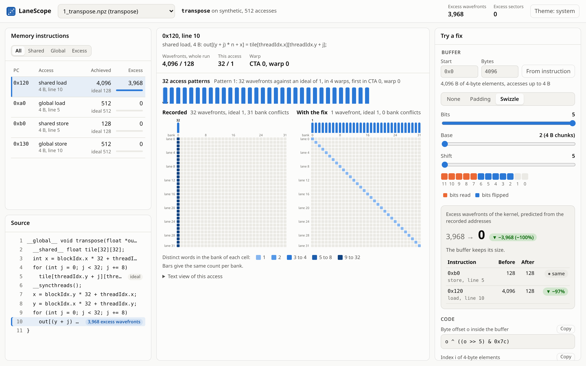

# LaneScope

LaneScope shows which lanes of a CUDA warp collide in the shared memory banks or scatter over global memory sectors. It predicts what a padding or an XOR swizzle would save before you write it.



Nsight Compute reports how many wavefronts an instruction takes. LaneScope records the address of every lane and draws each access as a grid of lanes and banks. It counts wavefronts and sectors per instruction the way Nsight Compute does. It then moves the recorded addresses through padding and swizzle layouts, ranks the layouts by the excess each one leaves, and gives each layout as C++ code, CuTe form included.

## Accuracy

The counts come from a model of the memory pipeline, measured against Nsight Compute 2026.3 on an RTX 4060 Laptop GPU (sm_89).

| Test | Counts equal to Nsight Compute |
|---|---|
| 60 calibration launches | 210 of 210 |
| 300 random lane patterns kept out of the fit | 596 of 600 |
| Padding and swizzle of a tiled transpose, predicted from the plain kernel | 4 of 4 |

The tests check the model against all 1,055 measured patterns in `tests/data/rtx4060_counts.json`. `lanescope validate` repeats the check on your GPU.

## Quick start

The demo needs Python 3.10 or later and no GPU.

```bash
python3 -m venv .venv && . .venv/bin/activate
pip install -e .
lanescope gui --demo
```

The page opens at http://localhost:8765 with three demo kernels. On Ubuntu, `sudo apt install python3-venv` adds the `venv` module.

## Your own kernels

Recording needs an NVIDIA GPU with its driver and `g++`. The `gpu` extra installs the CUDA tools as Python wheels.

```bash
pip install -e ".[gpu]"
lanescope record --out run1 -- ./my_app
lanescope gui run1
```

The command line gives the same analyses with `explain`, `lanes`, `whatif`, `suggest`, and `report`. `lanescope mcp` serves them to coding agents over MCP.

## Check on your GPU

```bash
lanescope get-ncu
lanescope validate --out check --random 300 --seed 3
```

`get-ncu` downloads the Nsight Compute that suits your driver, without root. Under WSL2, Nsight Compute also needs the NVIDIA Control Panel setting that allows access to the GPU performance counters. `scripts/gpu_validate.sh` runs the whole check from a fresh virtual environment.

## How it works

A Compute Sanitizer tool patches each shared and global memory instruction and writes one record per warp-level access with the address of every active lane. nvdisasm maps each record to its SASS instruction and its source line. The model knows the 32 banks of shared memory, the lane groups of 64-bit and 128-bit accesses with the cases where the hardware merges them, and the 32-byte sectors of global memory. A layout change moves every recorded address inside the chosen buffer and counts again.

| Folder | Contents |
|---|---|
| `src/lanescope/model` | wavefronts, sectors, and counters per instruction |
| `src/lanescope/fixes` | padding and swizzle layouts, their ranking, and their C++ code |
| `src/lanescope/recorder` | the Compute Sanitizer tool and the import of its records |
| `src/lanescope/nsight` | calibration kernels, Nsight Compute reports, and the GPU check |
| `src/lanescope/cuda` | the CUDA driver, NVRTC, nvdisasm, and the toolchain search |
| `src/lanescope/gui` | the local web server and the page |

## Development

```bash
pip install -e ".[gpu,mcp]" pytest ruff pyright playwright
python -m playwright install chromium-headless-shell
pytest
```

`requirements.txt` pins the versions that the tests last passed with.

## License

MIT
