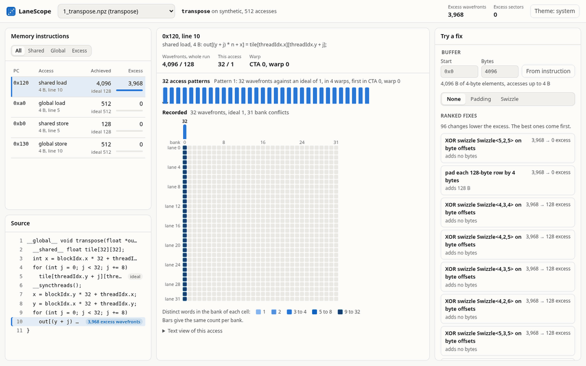

# LaneScope

[](https://github.com/aalramadan/lanescope/actions/workflows/tests.yml)
[](pyproject.toml)
[](LICENSE)
[](#accuracy)

LaneScope is a profiler for shared-memory bank conflicts in CUDA kernels. It records the memory address of every thread in each warp, shows which threads collide in the same bank, and predicts the padding or XOR swizzle that removes each conflict before any code changes.

## Installation

LaneScope requires Python 3.10 or later. The analysis tools and the GUI run without a GPU.

```bash
git clone https://github.com/aalramadan/lanescope.git
cd lanescope
python3 -m venv .venv && . .venv/bin/activate
pip install .            # analysis, command line, and GUI
pip install ".[gpu]"     # recording on an NVIDIA GPU
```

Recording needs the setup listed under [Requirements](#requirements). On Ubuntu, `sudo apt install python3-venv g++` installs the two system packages.

## Quick Start

```bash
lanescope gui --demo
```

The command serves the GUI at http://localhost:8765 with three demo kernels. The first is the tiled matrix transpose of the CUDA samples, which has a 32-way bank conflict. Each step of the swizzle control halves the conflict, from 32 wavefronts per warp to one.



## Features

| Feature | Description |
|---|---|
| Lane view | Shows each shared and global memory instruction lane by lane, beside its source line |
| Hardware counts | Reports the wavefronts and sectors that Nsight Compute reports, for loads, stores, `ldmatrix`, and `cp.async` |
| Layout search | Ranks the paddings and XOR swizzles of each buffer by the wavefronts each one removes |
| Code output | Writes the chosen layout as a byte offset, an element index, a 2D array index, or a CuTe `Swizzle<B, M, S>` |
| No rebuild | Records any CUDA program through a Compute Sanitizer tool, with no change to its build |
| Three interfaces | Offers a browser GUI, a command line, and a Model Context Protocol (MCP) server for coding agents |

## Usage

### Analyze a Trace

`lanescope explain` lists the counters of every memory instruction, worst first. The example analyzes the demo trace of the tiled transpose.

```console
$ lanescope demo --out transpose.npz
$ lanescope explain transpose.npz
kernel transpose (synthetic), 512 warp-level accesses

pc       line  space  kind  width  requests  unit        achieved  ideal excessive
0x0120     10  shared load      4       128  wavefronts      4096    128      3968
0x00a0      5  global load      4       128  sectors          512    512         0
0x00b0      5  shared store     4       128  wavefronts       128    128         0
0x0130     10  global store     4       128  sectors          512    512         0
```

The shared load at line 10 takes 4096 wavefronts against an ideal of 128. Nsight Compute counts each pass of a shared-memory access as one wavefront.

### Inspect One Instruction

`lanescope lanes` shows where each lane of one warp lands.

```console
$ lanescope lanes transpose.npz --pc 0x120
pc 0x0120, shared load of 4 bytes, CTA 0, warp 0
32 wavefronts against an ideal of 1, 31 bank conflicts

phase 1, lanes 0-31, 32 wavefronts, worst bank 0
bank    00000000001111111111222222222233
        01234567890123456789012345678901
lane  0 A...............................  offset 0x0
lane  1 B...............................  offset 0x80
lane  2 C...............................  offset 0x100
...
lane 31 f...............................  offset 0xf80
```

The 32 lanes read words that lie 128 bytes apart. Every word falls in bank 0. The load therefore needs 32 passes.

### Find a Fix

`lanescope suggest` ranks the layouts of each buffer by the excess wavefronts that remain.

```console
$ lanescope suggest transpose.npz
buffer 0x0+4096
XOR swizzle Swizzle<5,2,5> on byte offsets: excessive wavefronts 3968 -> 0, 0 extra bytes
pad each 128-byte row by 4 bytes: excessive wavefronts 3968 -> 0, 128 extra bytes
...
```

For a `float tile[32][32]`, the top-ranked swizzle changes one index.

```cpp
tile[r][c ^ (r & 0x1f)]   // CuTe: Swizzle<5, 0, 5>
```

`lanescope whatif` reports the counters for a single layout change. The commands `explain`, `whatif`, and `suggest` accept `--json` for use in scripts.

### Record a CUDA Program

```bash
lanescope record --out run1 -- ./my_app --size 4096
```

The command runs the program under the recorder and prints the path of each trace it writes. Compile the program with `-lineinfo` to map instructions to source lines.

| Option | Effect |
|---|---|
| `--kernel TEXT` | Records only the kernels whose names contain TEXT |
| `--ctas FIRST:COUNT` | Records a range of thread blocks, by default 64 blocks from the first |
| `--arch ARCH` | Sets the GPU architecture, such as `sm_89`, by default that of the local GPU |

Recording slows the program down. On large programs, limit it with `--kernel` and `--ctas`, then open the folder with `lanescope gui run1`.

### Use with Coding Agents

```bash
pip install ".[mcp]"
lanescope mcp
```

The command serves the analyses over MCP on standard input and output. An MCP client adds it with the command `lanescope` and the argument `mcp`.

## Accuracy

LaneScope computes its counts from the recorded addresses with a model of the hardware. The model is validated against Nsight Compute 2026.3 on an NVIDIA GeForce RTX 4060 Laptop GPU (sm_89). One run of the commands below gives the following counts.

| Test | Counts equal to Nsight Compute |
|---|---|
| 57 calibration launches of loads and stores | 114 of 114 |
| 52 calibration launches of `ldmatrix` and `cp.async` | 136 of 144 |
| 300 random loads and stores, kept out of the fit | 596 of 600 |
| 300 random `ldmatrix` and `cp.async` patterns, kept out of the fit | 790 of 866 |
| Plain, padded, and swizzled transpose | 96 of 96 |
| Padded and swizzled transpose, predicted from the plain one | 4 of 4 |

Every count of `ldmatrix` matches. Each miss of the `ldmatrix` and `cp.async` launches comes from 16-byte `cp.async`, as [Limitations](#limitations) describes. The test suite checks the model against every pattern measured on that GPU, 1,055 loads and stores in `tests/data/rtx4060_counts.json` and 637 `ldmatrix` and `cp.async` patterns in `tests/data/rtx4060_instruction_counts.json`. The same comparison runs on any supported GPU.

```bash
lanescope get-ncu                                      # installs Nsight Compute for the local driver
lanescope validate --out check --random 300 --seed 3
```

## Performance

`lanescope bench time` times the plain, padded, and swizzled transpose on the local GPU. On the RTX 4060 Laptop GPU, it gives the following.

```console
$ lanescope bench build --arch sm_89 --out bench.cubin
$ lanescope bench time --cubin bench.cubin
8192 x 8192 float matrix, 50 launches per kernel
kernel                     ms     GB/s  speedup
transpose_tile          2.618    205.1    1.00x
transpose_padded        2.403    223.4    1.09x
transpose_swizzled      2.273    236.2    1.15x
```

The swizzled kernel runs 1.15 times faster than the plain one in each of three runs. The padded kernel varies from 1.01 to 1.12 times between runs.

## Requirements

| Component | Requirement |
|---|---|
| Operating system | Linux or Windows Subsystem for Linux 2 (WSL2) |
| Python | 3.10 or later |
| GPU for recording | An NVIDIA GPU with a driver for CUDA 12.4 or later |
| Compiler for recording | `g++` |
| Validated GPU | GeForce RTX 4060 Laptop GPU (Ada, sm_89) |
| Newer GPUs | sm_90 and later use rules from the NVIDIA developer forum |

## How It Works

| Step | Module | Description |
|---|---|---|
| 1 | `recorder/` | Records the address of each active lane at every shared and global memory instruction, through Compute Sanitizer |
| 2 | `cuda/` | Maps each record to its SASS instruction and source line |
| 3 | `trace.py` | Stores the records of each kernel in a trace file |
| 4 | `model/` | Counts wavefronts and sectors from the addresses |
| 5 | `fixes/` | Applies each candidate layout to the addresses, counts again, and writes the code of the best |
| 6 | `gui/`, `cli.py`, `mcp_server.py` | Show the results in the browser, in the terminal, and to coding agents |
| 7 | `nsight/` | Validates the model against Nsight Compute |

The model counts one 4-byte word per bank per cycle in shared memory and aligned 32-byte sectors in global memory. Accesses of 8 and 16 bytes, `ldmatrix`, and `cp.async` follow rules measured on the GPU. All steps are deterministic and run locally.

## Limitations

- LaneScope models shared and global loads and stores, `ldmatrix`, and `cp.async`. It does not model atomic operations.
- The rules are calibrated on one GPU, the RTX 4060. LaneScope counts `stmatrix` with the rule of `ldmatrix`. That rule is not yet tested on sm_90 or newer, the only GPUs that run `stmatrix`.
- Eleven of the 1,055 measured loads and stores differ from Nsight Compute. All eleven are wide loads with inactive lanes.
- The model overcounts the shared-memory wavefronts of some 16-byte `cp.async` copies, such as 32 contiguous rows that start 16 bytes past a 128-byte boundary. LaneScope reports 32 wavefronts for that copy, compared with 12 from Nsight Compute. In the run above, the wavefronts match in 23 of the 42 launches of 16-byte `cp.async`.
- Nsight Compute reports global sectors for 16-byte `cp.async` that follow the shared-memory addresses, such as one sector when every lane writes the same row. LaneScope counts the sectors of the global addresses.

## Troubleshooting

| Message | Cause | Resolution |
|---|---|---|
| `Nsight Compute has no access to the GPU counters` | The driver restricts the performance counters | On Windows, select Enable Developer Settings in the Desktop menu of the NVIDIA Control Panel, then allow all users under Developer, Manage GPU Performance Counters. On Linux, set the `nvidia` module option `NVreg_RestrictProfilingToAdminUsers=0` and reboot |
| `missing CUDA tools` | The `gpu` extra is not installed | Run `pip install ".[gpu]"` |
| `C++ compiler not found` | `g++` is missing | Run `sudo apt install g++` |
| `cannot load the CUDA driver` | No GPU is visible | Recording and validation need a GPU. Analysis and the GUI do not |

## Development

```bash
pip install -e ".[gpu,mcp]" pytest ruff pyright playwright
python -m playwright install chromium-headless-shell
pytest
```

## Acknowledgments

The swizzle notation follows CuTe from NVIDIA CUTLASS. The rules for H100 and newer GPUs come from threads on the NVIDIA developer forum about `LDS.128` wavefronts.

## License

LaneScope is released under the MIT License. See [LICENSE](LICENSE).
