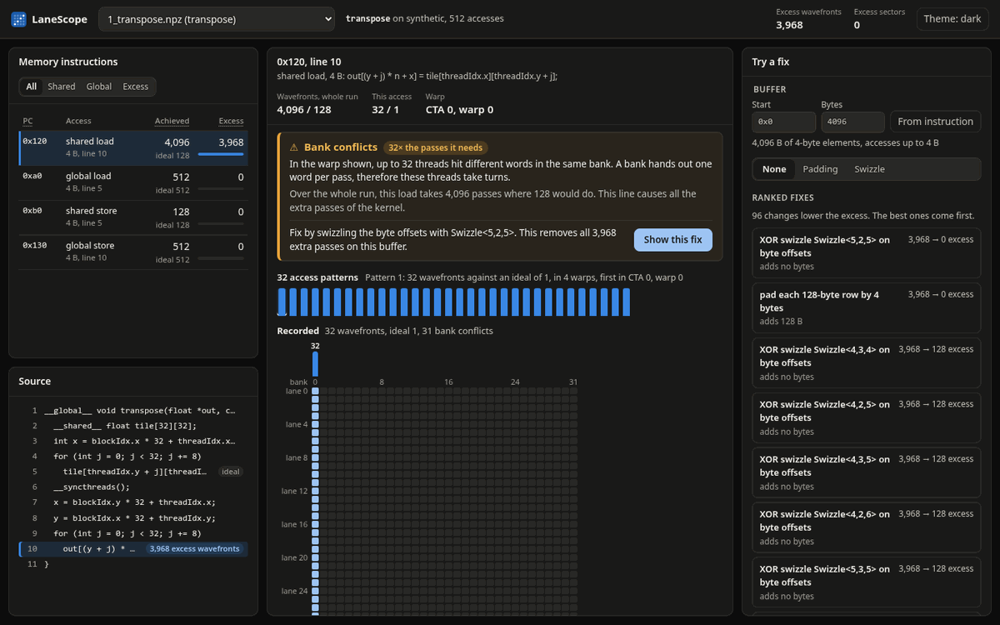

# LaneScope

[](https://github.com/aalramadan/LaneScope/actions/workflows/tests.yml)
[](pyproject.toml)
[](LICENSE)

Find and fix shared-memory bank conflicts in CUDA kernels.



LaneScope records the memory accesses of a running CUDA program, shows which threads collide in shared memory, and ranks the padding or swizzle that removes each conflict. The demo also runs in the browser at https://aalramadan.github.io/LaneScope/ with no install.

## Highlights

| Feature | Description |
|---|---|
| Thread view | Every shared and global memory access, thread by thread, beside its source line |
| Hardware counts | The wavefronts and sectors that Nsight Compute reports |
| Fix search | Paddings and swizzles ranked by the conflicts each removes, written as code |
| No rebuild | Any CUDA program, including the Triton kernels that PyTorch compiles |
| Three interfaces | A browser GUI, a command line, and an MCP server for coding agents |

## Installation

```bash
git clone https://github.com/aalramadan/LaneScope.git
cd LaneScope
pip install .            # analysis, command line, and GUI
pip install ".[gpu]"     # recording on an NVIDIA GPU
```

## Quick Start

```bash
lanescope gui --demo                          # the GUI with four demo kernels
lanescope record --out run1 -- ./my_app       # record a CUDA program
lanescope gui run1                            # explore the recording
lanescope suggest run1/trace-0.npz            # rank the fixes in the terminal
```

## Usage

### Find the Conflicts

`lanescope explain` lists the memory instructions of a trace, worst first.

```console
$ lanescope demo --out transpose.npz
$ lanescope explain transpose.npz
kernel transpose (synthetic), 512 warp-level accesses

pc       line  space  kind  width  requests  unit        achieved  ideal excessive
0x0120     10  shared load      4       128  wavefronts      4096    128      3968
0x00a0      5  global load      4       128  sectors          512    512         0
0x00b0      5  shared store     4       128  wavefronts       128    128         0
0x0130     10  global store     4       128  sectors          512    512         0
```

The shared load at line 10 takes 4,096 wavefronts, 32 times its ideal of 128.

### Fix Them

`lanescope suggest` ranks the layouts of each buffer by the conflicts each layout removes.

```console
$ lanescope suggest transpose.npz
buffer 0x0+4096
XOR swizzle Swizzle<5,2,5> on byte offsets: excessive wavefronts 3968 -> 0, 0 extra bytes
pad each 128-byte row by 4 bytes: excessive wavefronts 3968 -> 0, 128 extra bytes
...
```

For a `float tile[32][32]`, the top-ranked swizzle changes one index.

```cpp
tile[r][c ^ (r & 0x1f)]   // CuTe: Swizzle<5, 0, 5>
```

### Record Your Own Program

```bash
lanescope record --out run1 -- ./my_app --size 4096
lanescope record --out triton --kernel matmul_kernel -- python examples/triton_matmul.py
lanescope gui run1
```

`--kernel` records only the kernels whose names contain the given text. `--ctas` records a range of thread blocks. Compile with `-lineinfo` to see source lines.

### Use with Coding Agents

```bash
pip install ".[mcp]"
lanescope mcp
```

An MCP client adds the server with the command `lanescope` and the argument `mcp`.

## Commands

| Command | Description |
|---|---|
| `record` | Records the memory accesses of a CUDA or Python program |
| `gui` | Opens the browser GUI |
| `explain` | Lists the memory instructions of a trace, worst first |
| `lanes` | Shows where each thread of a warp lands |
| `suggest` | Ranks the paddings and swizzles of each buffer |
| `validate` | Compares the counts with Nsight Compute |
| `mcp` | Serves the analyses to coding agents |

Run `lanescope <command> --help` for the options of each command.

## Accuracy

On an RTX 4060 Laptop GPU, the counts of LaneScope match those of Nsight Compute in all 2,710 cases of its bench and in 2,027 of the 2,040 cases of the PyTorch and Triton examples. `lanescope validate` runs the same comparison on any GPU or program.

```bash
lanescope get-ncu                 # installs Nsight Compute for the local driver
lanescope validate --out check
```

## Performance

On the RTX 4060, the swizzle that LaneScope ranks first makes the transpose of its bench 1.13 to 1.19 times faster and its matrix multiply 1.72 to 1.77 times faster. `lanescope bench build` and `lanescope bench time` repeat these timings.

## Requirements

- Linux or WSL2 with Python 3.10 or later
- For recording, `g++` and an NVIDIA GPU with a driver for CUDA 12.4 or later
- Validated on an RTX 4060 Laptop GPU

## How It Works

| Step | Module | Description |
|---|---|---|
| 1 | `recorder/` | Records the address of each thread at every memory access, through Compute Sanitizer |
| 2 | `model/` | Counts wavefronts and sectors from the addresses |
| 3 | `fixes/` | Tries paddings and swizzles on the recorded addresses and ranks them |
| 4 | `gui/`, `cli.py`, `mcp_server.py` | Show the results |
| 5 | `nsight/` | Checks the counts against Nsight Compute |

## Development

```bash
pip install -e ".[gpu,mcp]" pytest ruff pyright playwright
python -m playwright install chromium-headless-shell
pytest
```

## Acknowledgments

The swizzle notation follows CuTe from NVIDIA CUTLASS. The rules for H100 and newer GPUs come from the NVIDIA developer forum.

## License

LaneScope is released under the MIT License. See [LICENSE](LICENSE).
